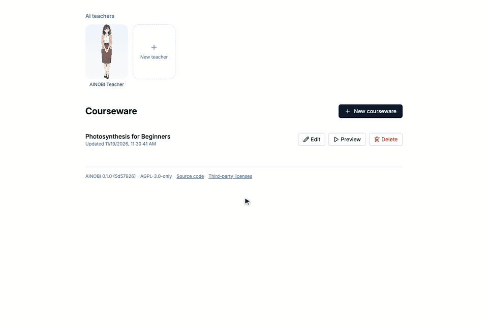
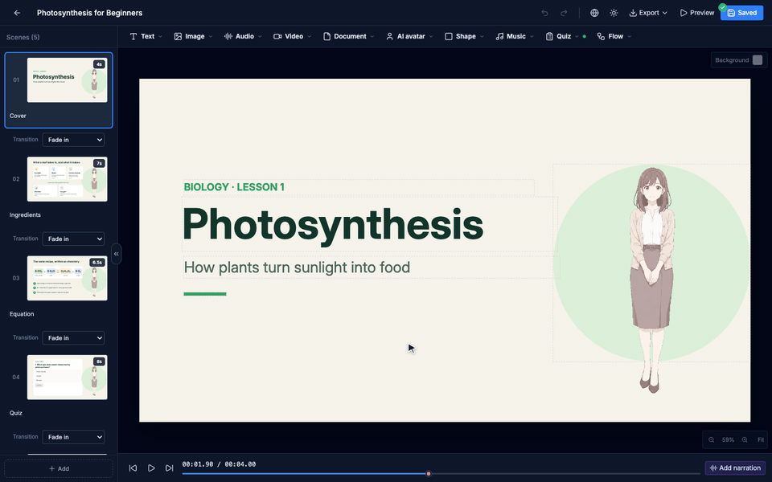

<div align="center">


# AINOBI

**教材の作成・再生とアバター。必要なのは Node.js だけ。**

[クイックスタート](#クイックスタート) · [必要なものを選ぶ](#必要なものだけを選ぶ) · [エージェントから使う](#コーディングエージェントから使う) · [コンポーネント](docs/components.md) · [統合ガイド](docs/integration.md)

[English](README.md) · 日本語 · [简体中文](README.zh-CN.md)

</div>

> このページは [README.md](README.md) の翻訳です。内容に相違がある場合は英語版を正とします。リンク先のドキュメントは英語です。

AINOBI は、AI を基盤とした教育コンテンツ制作システムで、まるごと動かすことも、部品に分けて使うこともできます。コマンド 1 つで全体を起動することも、アバターだけ、プレーヤーだけ、エディターだけを自分のアプリに組み込むこともできます。

<p align="center">
  
</p>

## クイックスタート

[Node.js](https://nodejs.org) 22.12 以降（22、24、またはそれより新しい偶数バージョン）をインストールします。このクイックスタートに必要なものはそれだけです。Docker も、データベースも、Redis も要りません。

```sh
git clone https://github.com/GeekAcaCompany/AINOBI.git
cd AINOBI
npm start
```

初回はインストールとビルドを行うため、数分かかります。その後 <http://127.0.0.1:5600> を開くと教材一覧が表示され、それぞれの教材を編集・プレビューできます。作業内容はこのディレクトリの `.ainobi/` に保存されます。

<p align="center">
  
</p>

これは AINOBI を動かすための最小構成であり、この構成に限定されるわけではありません。データベースは PGlite（WebAssembly で動く PostgreSQL）、Redis はインメモリのサーバー、オブジェクトはディスク上のファイルで、すべて Node.js プロセスの中で動くため、インストールや設定は何も要りません。1 台のマシンで 1 人が使うのに向いています。ユーザーは 1 人で、ログインはありません。複数人で使う場合は、教材サービスの前段に自前のログイン機能を置き、3 つのストアのうち必要なものを自前のサーバーに置き換えてください。[自前のデータベース、Redis、ストレージ](#自前のデータベースredisストレージ)を参照してください。

信頼できる教材だけを開いてください。スライドには HTML を含めることができ、そのスクリプトは Studio 上であなたの権限で実行されます。つまり、他人の教材は他人のプログラムと同じです。[SECURITY.md](SECURITY.md) を参照してください。

更新するには、pull してインストールし、再ビルドします。`npm start` は不足しているものだけをビルドするため、`--rebuild` を付けないと古いビルドのまま動き続けます。

```sh
git pull
npx pnpm@10.5.0 install
npm start -- --rebuild
```

ポートが使用中の場合、`npm start` は停止してそのポートを表示します。`.env.local` に `AINOBI_PORT_OFFSET=100` を追加するとすべてのポートがまとめてずれ、Studio は <http://127.0.0.1:5700> になります。

ビルドが `An Application Control policy has blocked this file` で止まる場合、Windows がコンパイル済みの依存ファイルを、その置き場所を理由に拒否しています。一時ディレクトリではなく、通常のプロジェクト用ディレクトリにクローンしてください。

## 必要なものだけを選ぶ

目的を果たせる最小の部品から始めてください。各行は、その部品とそれが依存するものだけをインストールします。

| やりたいこと | 実行するコマンド | 稼働中のサービスが必要？ |
| --- | --- | --- |
| React アプリにアバターを表示する | `npm run add -- avatar --to ../my-app` | 不要 |
| 教材 JSON を読み込む・検証する・編集する | `npm run add -- format --to ../my-app` | 不要 |
| スクリプトやエージェントから教材を作成する | `npm run add -- cli --to ../my-app` | 不要 |
| React アプリで教材を再生する | `npm run add -- player --to ../my-app` | 必要 |
| React アプリで教材を編集する | `npm run add -- editor --to ../my-app` | 必要 |
| 任意の Web ページにエディター、プレーヤー、アバターを埋め込む | `npm run add -- embed --to ../my-app` | 必要 |
| 完全な教材システムを手に入れる | `npm start` | これ自体がサービス |

[統合ガイド](docs/integration.md)には、それぞれのコードと、各部品を自前のユーザー管理やストレージにつなぐ方法が載っています。[コンポーネント一覧](docs/components.md)には、各パッケージの内容が正確に書かれています。

## コーディングエージェントから使う

Studio が動いていれば、Claude Code と Codex が教材を作成でき、作業が進むにつれて一覧に表示されます。`npm start` は接続情報を `.mcp.json` に書き込むので、Studio が `AINOBI Studio` の行を出力した後に、このディレクトリからエージェントを起動してください。すでに実行中のセッションは再起動が必要です。[docs/agents.md](docs/agents.md) を参照してください。

作業をまるごと任せることもできます。エージェントにこのリポジトリを渡して、こう伝えてください。

> AINOBI リポジトリを使って、教材一覧・編集・プレビューを備えた教材システムを構築し、あなたがその上で直接教材を作れるように設定してください。

[AGENTS.md](AGENTS.md) には、最小限のコンポーネントを選んでプロジェクトに組み込む方法が、エージェント向けに書かれています。

## ナレーションと AI採点には Gemini キーが必要

キーがなくても Studio は起動し、教材の編集と再生ができます。ナレーションと AI採点にはキーが必要です。[Google AI Studio](https://aistudio.google.com/apikey) で Gemini API キーを取得し、このフォルダの `.env.local` に追加して再起動してください。

```sh
GEMINI_API_KEY=your-key
```

このキーは、30 種類のボイスによるナレーションと、記述式・シャドーイング・音声問題の AI採点に使われます。キーがない場合、Studio は起動時に警告を表示し、ナレーションと AI採点は使用時にエラーを返します。代わりに、サービスアカウントを使って両方を Google Cloud の Vertex AI 上で動かす場合は、[docs/google-cloud.md](docs/google-cloud.md) を参照してください。

## そのまま使える機能

- **AI教師。** Studio には最初から 1 人用意されており、どのスライドにもすぐ追加できます。ナレーションには上記の Gemini キーが必要です。
- **クイズ。** 単一選択、複数選択、完全一致で判定する穴埋め問題はローカルで採点され、最後に得点ページが付きます。記述式、シャドーイング、音声問題は Gemini が採点します。

## 残りはエージェントが行う

AINOBI は、AIエージェントが作業することを前提にしています。そのエージェントはすでに調査ができ、多くの場合は絵も描けます。そのため、以下のワークフローは AINOBI が代わりに呼び出すサービスではなく、エージェントが自分の能力で実行するスキルです。キーが必要になるのは、エージェントにその能力がない場合だけです。

| スキル | エージェントが行うこと | エージェントにできない場合にのみ必要なキー |
| --- | --- | --- |
| [`ainobi-courseware`](skills/ainobi-courseware/SKILL.md) | 教材を計画・作成・編集する：スライド、レイアウト、クイズ、アニメーション、ナレーション | 不要。ただしナレーションには、どのエージェントでも `GEMINI_API_KEY` が必要 |
| [`ainobi-research`](skills/ainobi-research/SKILL.md) | 自身の Web 検索で調査と事実確認を行い、あなたのドキュメントを読む | `TAVILY_API_KEY`（Web 検索） |
| [`ainobi-images`](skills/ainobi-images/SKILL.md) | 自身の画像生成でイラストを描き、スライドに追加する | `OPENAI_API_KEY`（画像生成） |
| [`ainobi-ai-teacher`](skills/ainobi-ai-teacher/SKILL.md) | アニメーションする新しい AI教師を作る：エージェントがキャラクターを描いて各ステップを自分で確認し、Studio が切り出し・アニメーション化・組み立てを行う | `OPENAI_API_KEY`（画像生成） |

スキルは [Agent Skills](https://agentskills.io) 形式に従っています。[`skills/`](skills/) にあり、Claude Code は `.claude/skills/` から、Codex などのエージェントは `.agents/skills/` から見つけます。

## 人が使うためのオプション機能

エージェントを使わずブラウザで作業する人のための機能で、それぞれのキーを `.env.local` に追加するまで無効のままです。

| 機能 | 設定 |
| --- | --- |
| エディターの AIアシスタントパネル（両方を設定するまで非表示） | `ANTHROPIC_API_KEY` と `ANTHROPIC_BASE_URL` |
| Studio のホーム画面から新しい AI教師を生成する | `OPENAI_API_KEY` |

[`.env.example`](.env.example) に、これらを含む設定の一覧があります。

Node.js 以外のものが必要な機能が 2 つあり、どちらも、必要な場合にだけ自分で起動する Docker コンテナで動きます。教材の動画エクスポート（[docs/video-export.md](docs/video-export.md)）と、アップロードした PDF や PowerPoint ファイルをスライドに表示できるページへ変換する機能（[docs/document-conversion.md](docs/document-conversion.md)）です。

## 自前のデータベース、Redis、ストレージ

クイックスタートは組み込みのストアを使うので、どこでも動きます。教材サービスは一般的なプロトコルで通信するため、各ストアを個別に置き換えられます。

| ストア | クイックスタート | 置き換え先 | 設定 |
| --- | --- | --- | --- |
| データベース | PGlite | 任意の PostgreSQL サーバー | `DB_*` |
| キャッシュとストリーム | インメモリの Redis サーバー | 任意の Redis サーバー | `REDIS_*` |
| 教材アセット | ディスク上のファイル | 任意の S3 互換ストレージ | `STORAGE_BACKEND=oci_s3` と `OCI_S3_*` |

`npm start` は常に組み込みのストアを使います。1 台のマシン向けで、ユーザーは 1 人、ループバックでのみ待ち受けます。自前のサーバーを使うには、これらの設定で教材サービスを起動し、自前のログイン機能と組み合わせてください。[統合ガイド](docs/integration.md#connecting-your-own-system)に、すべての設定とテーブルの作成方法が載っています。

## ドキュメント

- [コンポーネント一覧](docs/components.md)
- [統合ガイド](docs/integration.md)
- [コーディングエージェントの利用](docs/agents.md)
- [Google Cloud でのナレーションと AI採点](docs/google-cloud.md)
- [動画エクスポート](docs/video-export.md)
- [ドキュメント変換](docs/document-conversion.md)
- [セキュリティ](SECURITY.md)と[プライバシー](docs/PRIVACY.md)
- [開発とコントリビューション](CONTRIBUTING.md)

## ライセンス

コード、ドキュメント、および Studio に付属する AI教師は、[GNU Affero General Public License v3.0 only](LICENSE) の下でライセンスされています。著作権は GeekAca Ltd. およびコントリビューターにあります。[NOTICE](NOTICE) を参照してください。外部からのコントリビューションには、署名済みの[コントリビューターライセンス契約](CLA.md)が必要です。

AINOBI の名称とロゴは GeekAca Ltd. の商標であり、このライセンスの対象外です。[TRADEMARKS.md](TRADEMARKS.md) を参照してください。Inochi2D ランタイムなどのサードパーティコンポーネントにはそれぞれのライセンス条件が適用され、エディターの AIアシスタントが使う Claude Agent SDK は Anthropic の利用条件に基づくプロプライエタリソフトウェアです。[THIRD_PARTY_NOTICES.md](THIRD_PARTY_NOTICES.md) を参照してください。あなたが作成またはアップロードした教材が、AINOBI を使ったことによってこのライセンスの対象になることはありません。

Studio のホーム画面には、実行中のコミットのソースとサードパーティ通知へのリンクがあり、そのコミットに含まれない変更がファイルにある場合はその旨も表示されます。変更したバージョンをネットワーク経由で他の人に使わせる場合、AGPL により、その利用者にそのソースを提供する必要があります。ルートの `package.json` の `repository` をそのソースの場所に向けてください。ホーム画面のリンクもそこを指すようになります。
