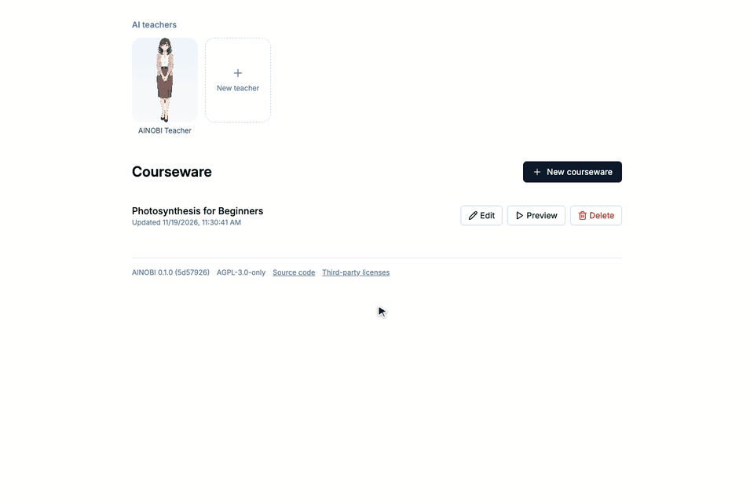
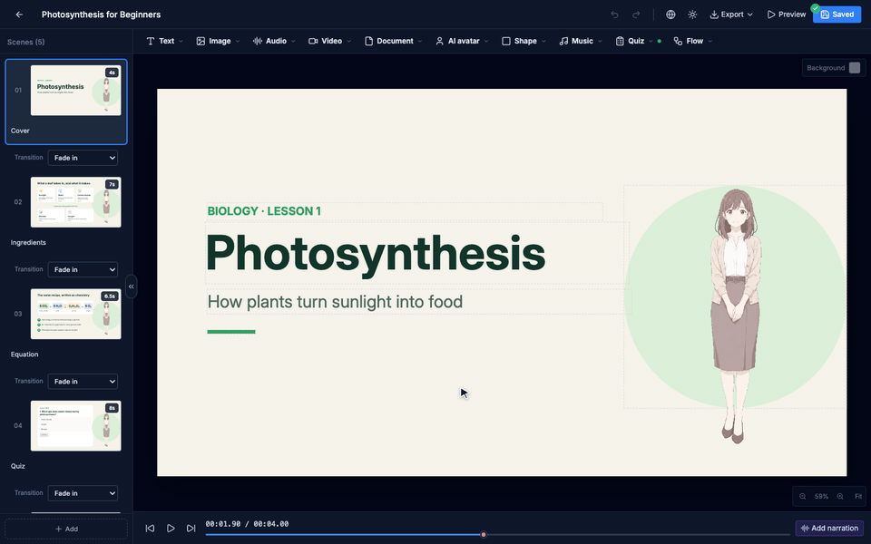

<div align="center">


# AINOBI

**课件制作、播放与数字人，只需要 Node.js。**

[快速开始](#快速开始) · [按需选用](#只选你需要的部分) · [让 Agent 来用](#在编程-agent-中使用) · [组件清单](docs/components.md) · [集成指南](docs/integration.md)

[English](README.md) · [日本語](README.ja.md) · 简体中文

</div>

> 本页译自 [README.md](README.md)，内容如有出入，以英文版为准。文中链接的其他文档均为英文。

AINOBI 是一套以 AI 为基础的教学内容创作系统，可以整体运行，也可以拆开使用。一条命令就能运行完整的系统，也可以只把数字人、播放器或编辑器装进你自己的应用。

<p align="center">
  
</p>

## 快速开始

安装 [Node.js](https://nodejs.org) 22.12 或更高版本（22、24，或更新的偶数版本）。快速开始不需要别的东西：不用 Docker，不用数据库，也不用 Redis。

```sh
git clone https://github.com/GeekAcaCompany/AINOBI.git
cd AINOBI
npm start
```

首次运行会安装依赖并构建，需要几分钟。之后打开 <http://127.0.0.1:5600>，可以看到课件列表，每个课件都能编辑和预览。你的内容保存在当前目录的 `.ainobi/` 中。

<p align="center">
  
</p>

这是运行 AINOBI 最精简的方式，并不是固定不变的选择。数据库是 PGlite（运行在 WebAssembly 中的 PostgreSQL），Redis 是内存服务器，对象存储用的是磁盘上的文件，全部运行在 Node.js 进程内，所以不需要安装或配置任何东西。它适合一个人在一台机器上使用：只有一个用户，没有登录。要给多人使用，请把课件服务部署在你自己的登录系统后面，并把这三种存储按需换成你自己的服务器，见[使用你自己的数据库、Redis 和存储](#使用你自己的数据库redis-和存储)。

只打开你信任的课件。幻灯片可以包含 HTML，其中的脚本会在 Studio 里以你的身份运行，所以来自他人的课件就相当于来自他人的程序，见 [SECURITY.md](SECURITY.md)。

更新时，依次拉取、安装、重新构建。`npm start` 只构建缺失的部分，所以不加 `--rebuild` 就会继续运行旧的构建：

```sh
git pull
npx pnpm@10.5.0 install
npm start -- --rebuild
```

如果端口被占用，`npm start` 会停下并指出是哪个端口。在 `.env.local` 中加上 `AINOBI_PORT_OFFSET=100`，所有端口会一起偏移，Studio 的地址就变成 <http://127.0.0.1:5700>。

如果构建因 `An Application Control policy has blocked this file` 而停止，说明 Windows 因为文件所在的位置而拒绝了某个编译好的依赖。请克隆到普通的项目目录，不要放在临时目录里。

## 只选你需要的部分

从能完成任务的最小部分开始。每一行只安装该部分及其依赖。

| 我想要 | 运行 | 需要运行中的服务吗？ |
| --- | --- | --- |
| 在我的 React 应用里显示数字人 | `npm run add -- avatar --to ../my-app` | 不需要 |
| 读取、校验或编辑课件 JSON | `npm run add -- format --to ../my-app` | 不需要 |
| 用脚本或 Agent 制作课件 | `npm run add -- cli --to ../my-app` | 不需要 |
| 在我的 React 应用里播放课件 | `npm run add -- player --to ../my-app` | 需要 |
| 在我的 React 应用里编辑课件 | `npm run add -- editor --to ../my-app` | 需要 |
| 在任意网页中嵌入编辑器、播放器或数字人 | `npm run add -- embed --to ../my-app` | 需要 |
| 拥有一套完整的课件系统 | `npm start` | 它本身就是服务 |

[集成指南](docs/integration.md)给出了每种用法的代码，以及如何把这些部分接入你自己的用户体系和存储。[组件清单](docs/components.md)准确列出了每个包里有什么。

## 在编程 Agent 中使用

Studio 运行时，Claude Code 和 Codex 可以制作课件，课件会随着它们的工作出现在列表里。`npm start` 会把连接信息写入 `.mcp.json`，所以请在 Studio 输出 `AINOBI Studio` 那一行之后，从当前目录启动你的 Agent；已经在运行的会话需要重启。见 [docs/agents.md](docs/agents.md)。

也可以把整件事都交给 Agent 来做。把这个仓库交给它，然后说：

> 用 AINOBI 仓库帮我搭建一套课件系统，要有课件列表、编辑和预览，并配置好，让你可以直接在上面制作课件。

[AGENTS.md](AGENTS.md) 会告诉 Agent 如何选出最小的一组组件，并把它们集成到你的项目里。

## 语音讲解和 AI 评分需要 Gemini Key

不需要任何 Key，Studio 就能启动，你也可以编辑和播放课件。语音讲解和 AI 评分则需要一个 Key：在 [Google AI Studio](https://aistudio.google.com/apikey) 获取 Gemini API Key，把它加到当前目录的 `.env.local` 中，然后重启：

```sh
GEMINI_API_KEY=your-key
```

它用于语音讲解（共 30 种音色），以及问答题、跟读题和语音题的 AI 评分。没有它，Studio 会在启动时提醒你，语音讲解和 AI 评分在使用时会报错。如果想改为通过服务账号在 Google Cloud Vertex AI 上运行这两项功能，见 [docs/google-cloud.md](docs/google-cloud.md)。

## 开箱即用的功能

- **AI 教师**：Studio 自带一位，可以直接加到任意幻灯片上。它的语音讲解需要上面的 Gemini Key。
- **测验**：单选题、多选题和精确匹配的填空题在本地评分，最后有成绩页。问答题、跟读题和语音题由 Gemini 评分。

## 其余的交给你的 Agent

AINOBI 假定有一个 AI Agent 在使用它，而这个 Agent 本来就会查资料，往往还会画图。所以下面这些工作流是你的 Agent 凭自身能力执行的技能，而不是 AINOBI 替它调用的服务。只有在你的 Agent 不具备相应能力时才需要 Key：

| 技能 | 你的 Agent 做什么 | 仅当 Agent 做不到时才需要的 Key |
| --- | --- | --- |
| [`ainobi-courseware`](skills/ainobi-courseware/SKILL.md) | 规划、制作和编辑课件：幻灯片、布局、测验、动画和语音讲解 | 不需要；但无论用哪个 Agent，语音讲解都需要你的 `GEMINI_API_KEY` |
| [`ainobi-research`](skills/ainobi-research/SKILL.md) | 用自己的网页搜索查资料、核对事实，并阅读你的文档 | `TAVILY_API_KEY`（网页搜索） |
| [`ainobi-images`](skills/ainobi-images/SKILL.md) | 用自己的图像生成能力绘制插图，并加到幻灯片上 | `OPENAI_API_KEY`（图像生成） |
| [`ainobi-ai-teacher`](skills/ainobi-ai-teacher/SKILL.md) | 创建一位新的、会动的 AI 教师：Agent 自己绘制角色并检查每一步，Studio 负责切分、制作动画和组装 | `OPENAI_API_KEY`（图像生成） |

这些技能遵循 [Agent Skills](https://agentskills.io) 格式，放在 [`skills/`](skills/) 中。Claude Code 通过 `.claude/skills/` 找到它们，Codex 和其他 Agent 则通过 `.agents/skills/`。

## 给人用的可选功能

这些功能是给不借助 Agent、直接在浏览器里操作的人准备的；在你把对应的 Key 加到 `.env.local` 之前，它们都处于关闭状态：

| 功能 | 设置 |
| --- | --- |
| 编辑器中的 AI 助手面板（两项都设置后才显示） | `ANTHROPIC_API_KEY` 和 `ANTHROPIC_BASE_URL` |
| 在 Studio 首页生成新的 AI 教师 | `OPENAI_API_KEY` |

[`.env.example`](.env.example) 列出了这些设置以及更多设置。

有两项功能除了 Node.js 还需要别的东西，它们各自运行在一个 Docker 容器里，需要用到时再由你自己启动：把课件导出为视频（[docs/video-export.md](docs/video-export.md)），以及把上传的 PDF 和 PowerPoint 文件转换成幻灯片可以展示的页面（[docs/document-conversion.md](docs/document-conversion.md)）。

## 使用你自己的数据库、Redis 和存储

快速开始用的是内嵌存储，所以在哪里都能运行。课件服务使用的是通用协议，所以每种存储都可以单独替换：

| 存储 | 快速开始 | 可替换为 | 设置 |
| --- | --- | --- | --- |
| 数据库 | PGlite | 任意 PostgreSQL 服务器 | `DB_*` |
| 缓存和流 | 内存 Redis 服务器 | 任意 Redis 服务器 | `REDIS_*` |
| 课件资源 | 磁盘上的文件 | 任意兼容 S3 的存储 | `STORAGE_BACKEND=oci_s3` 和 `OCI_S3_*` |

`npm start` 始终使用内嵌存储：它面向单机使用，只有一个用户，并且只监听本机回环地址。要使用你自己的服务器，请用这些设置运行课件服务，并配上你自己的登录系统。[集成指南](docs/integration.md#connecting-your-own-system)列出了每一项设置以及建表的方法。

## 文档

- [组件清单](docs/components.md)
- [集成指南](docs/integration.md)
- [使用编程 Agent](docs/agents.md)
- [在 Google Cloud 上运行语音讲解和 AI 评分](docs/google-cloud.md)
- [视频导出](docs/video-export.md)
- [文档转换](docs/document-conversion.md)
- [安全](SECURITY.md)和[隐私](docs/PRIVACY.md)
- [开发与贡献](CONTRIBUTING.md)

## 许可证

代码、文档以及 Studio 自带的 AI 教师均以 [GNU Affero General Public License v3.0 only](LICENSE) 授权。版权归 GeekAca Ltd. 及贡献者所有，见 [NOTICE](NOTICE)。提交贡献即表示你同意[贡献者许可协议](CLA.md)，无需另行签署。

AINOBI 名称和标志是 GeekAca Ltd. 的商标，不在本许可证的授权范围内，见 [TRADEMARKS.md](TRADEMARKS.md)。第三方组件（例如 Inochi2D 运行时）适用其各自的条款，编辑器的 AI 助手所使用的 Claude Agent SDK 是适用 Anthropic 条款的专有软件，见 [THIRD_PARTY_NOTICES.md](THIRD_PARTY_NOTICES.md)。你创建或上传的课件不会因为使用 AINOBI 而受本许可证约束。

Studio 首页链接到它所运行的那次提交的源代码和第三方声明，并在文件含有该提交未包含的修改时予以说明。如果你让其他人通过网络使用修改后的版本，AGPL 要求你向他们提供其源代码：把根目录 `package.json` 中的 `repository` 指向修改版的源代码，首页上的源代码链接就会跟着指向那里。
