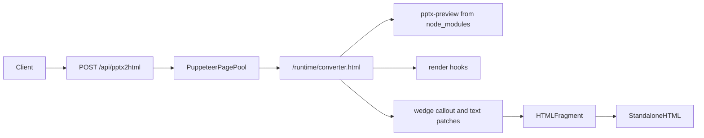

# Ainobi PPTX to HTML Service

Node/Express service that converts uploaded PPTX files to standalone HTML through a Puppeteer-hosted browser runtime.

## Runtime Flow



`runtime/converter.html` loads first-party runtime patches from `runtime/` and JSZip from `runtime/vendor/`. `pptx-preview` is served from the installed npm package at `/runtime/vendor/pptx-preview.umd.js`. The runtime asset paths are absolute `/runtime/...` URLs, so both the service and CLI mount them through `src/static-runtime.js`.

## API

Start the service:

```sh
pnpm install
pnpm start
```

Convert a PPTX:

```sh
curl -F "pptx=@presentation.pptx" http://localhost:3000/api/pptx2html
```

Successful responses have this shape:

```json
{
  "ok": true,
  "html": "<!DOCTYPE html>...",
  "elapsedMs": 1234,
  "bytes": 123456
}
```

Upload a raw PPTX to OSS:

```sh
curl -F "pptx=@presentation.pptx" http://localhost:3000/api/upload
```

The service stores raw PPTX objects under `raw/pptx/{pptx_id}.pptx`. By default `pptx_id` is the uploaded file's MD5, so uploading the same file can reuse the existing raw object. You can also pass an existing UUID or MD5 with `-F "pptx_id=<id>"`.

Convert a previously uploaded PPTX and cache each slide as standalone HTML:

```sh
curl -X POST -H "Content-Type: application/json" \
  -d '{"pptx_id":"<md5>"}' \
  http://localhost:3000/api/pptx2html
```

Per-slide HTML artifacts are stored under `artifact/pptx/{pptx_id}/html/slide_{index + 1}.html`.

## CLI

```sh
pnpm convert ./presentation.pptx -o ./presentation.html
```

Generated `.html` and `.pptx` fixture files are intentionally ignored by git.

## Configuration

Copy `.env.example` to `.env` for local overrides.

- `PORT` defaults to `3000` and controls the HTTP port.
- `MAX_FILE_SIZE_MB` defaults to `100` and controls the upload size limit.
- `PPTX_POOL_SIZE` defaults to `2` and controls the number of warm Puppeteer converter pages.
- `RUNTIME_READY_TIMEOUT_MS` defaults to `30000` and controls runtime page readiness timeout.
- `PUPPETEER_HEADLESS` defaults to `true`; set `false` for local browser debugging.
- `PUPPETEER_EXECUTABLE_PATH` is optional locally and required in Docker.
- `PUPPETEER_ARGS` is a comma-separated Chromium arg list.
- `HTML_MINIFY` defaults to `true`; set `false` to skip output minification.
- `OSS_REGION` / `OSS_ENDPOINT` configure the Aliyun OSS region or custom overseas endpoint.
- `OSS_BUCKET`, `ALIYUN_ACCESS_KEY_ID`, and `ALIYUN_ACCESS_KEY_SECRET` are required for OSS upload/download.
- `OSS_STS_TOKEN` is optional for temporary credentials.
- `OSS_SECURE` defaults to `true`.
- `OSS_TIMEOUT` defaults to `300s` for overseas OSS uploads.
- `OSS_MULTIPART_THRESHOLD_MB` defaults to `1`; files at or above this size use OSS multipart upload.
- `OSS_MULTIPART_PART_SIZE_MB` defaults to `1`.
- `OSS_MULTIPART_PARALLEL` defaults to `3`.
- `OSS_ARTIFACT_UPLOAD_CONCURRENCY` defaults to `4`: how many slide HTML artifacts upload at once (each may use `OSS_MULTIPART_PARALLEL` sockets).

## Third-party libraries

### pptx-preview

`pptx-preview` is used as its npm package publishes it. The repository keeps no copy of the library and changes none of its code: `src/static-runtime.js` serves `dist/pptx-preview.umd.js` from `node_modules`, and the Docker image carries it there too.

The package declares the ISC license. The author's repository adds that the npm package is free to use, privately and commercially, and that its source may not be modified and republished as another open-source project. Keep to both: do not copy the library into this repository, and do not patch its files.

Where its output needs correcting, `runtime/preview-render-hooks.js` does it from outside. It wraps the previewer's node renderer, and:

- treats a shape or table cell line with `a:noFill` as no border, so that an inherited line style does not draw one;
- gives a picture its own box, with its flip and rotation;
- sizes a table to its frame, and a merged cell to the columns it spans;
- lets paragraphs break between words.

The hooks read the library's parsed nodes and its renderer's `_renderNode` method. Neither is a documented interface, so after upgrading `pptx-preview`, convert a presentation with tables, pictures, and grouped shapes and compare the result. If the renderer is no longer there, conversion fails with an error that says so.

### JSZip

`runtime/vendor/jszip.min.js` is copied, unmodified, from the installed `jszip` package, with the license texts of what it contains in `runtime/vendor/licenses/`:

```sh
pnpm vendor:runtime
```

Keep `jszip` at `2.x` unless `runtime/wedge-callout-pptx.js` is updated, because that file uses the `new JSZip(buffer)` API. JSZip is used under its MIT option and contains pako, lie, and immediate; add an entry to the sync script's `licenses` list when the bundle gains a dependency.

## Docker

Build from the repository root (the image installs from the root lockfile):

```sh
docker build -f apps/pptx2html-service/Dockerfile -t ainobi-pptx2html-service .
docker run --rm -p 3000:3000 ainobi-pptx2html-service
```

The image installs Chromium and runs with `PUPPETEER_EXECUTABLE_PATH=/usr/bin/chromium`.
